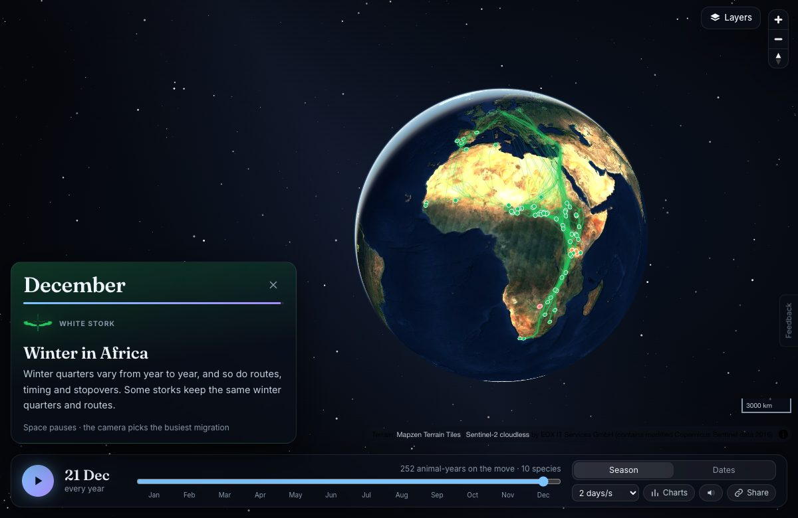
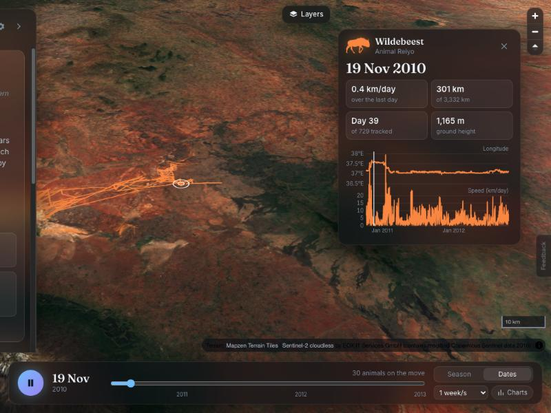
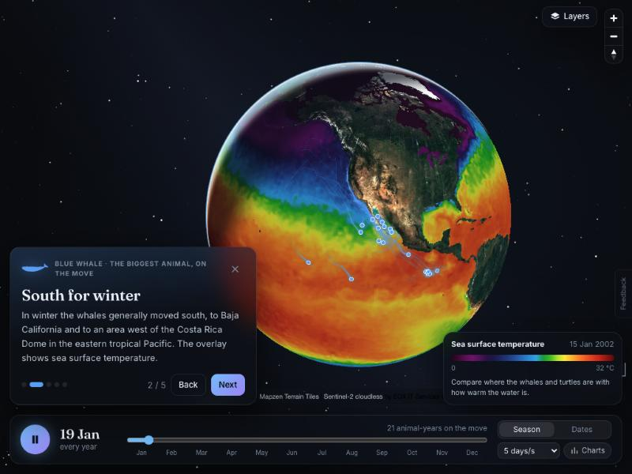
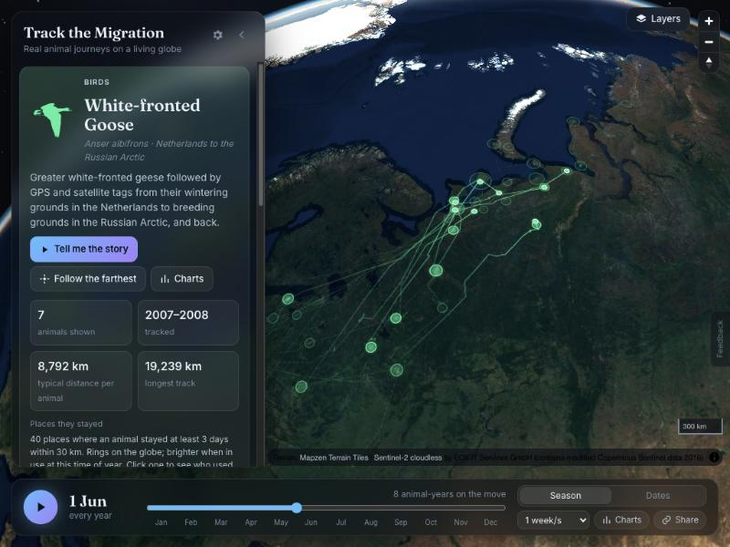
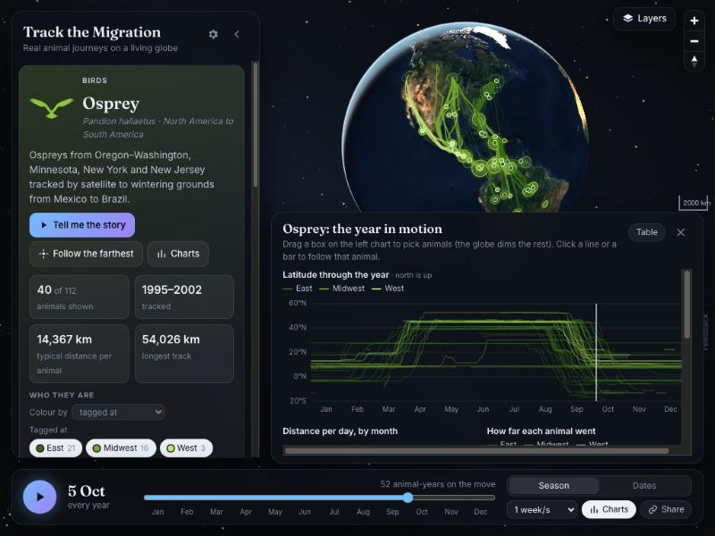
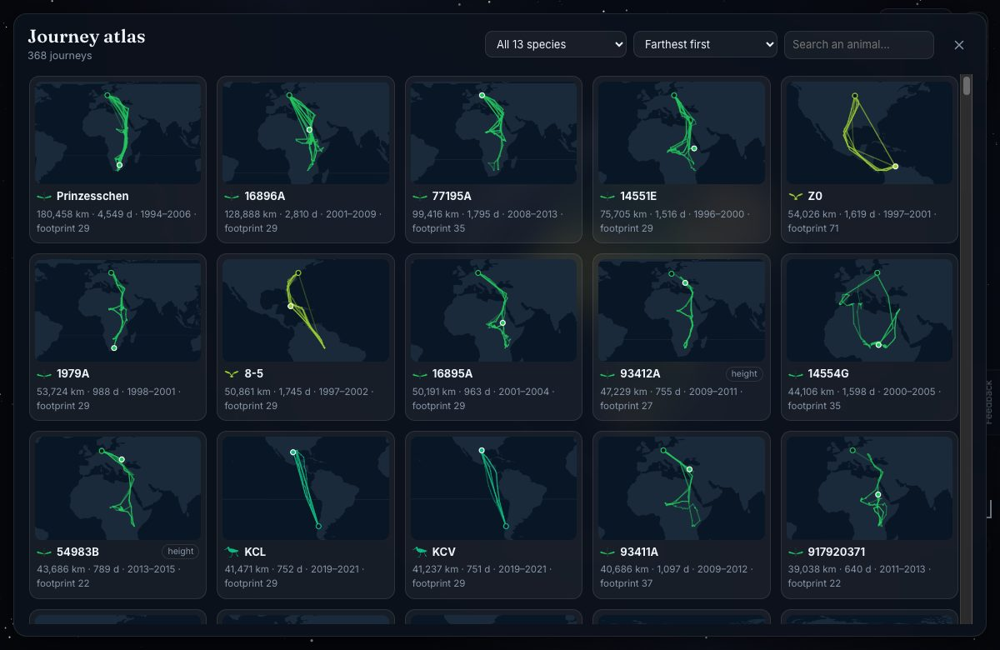
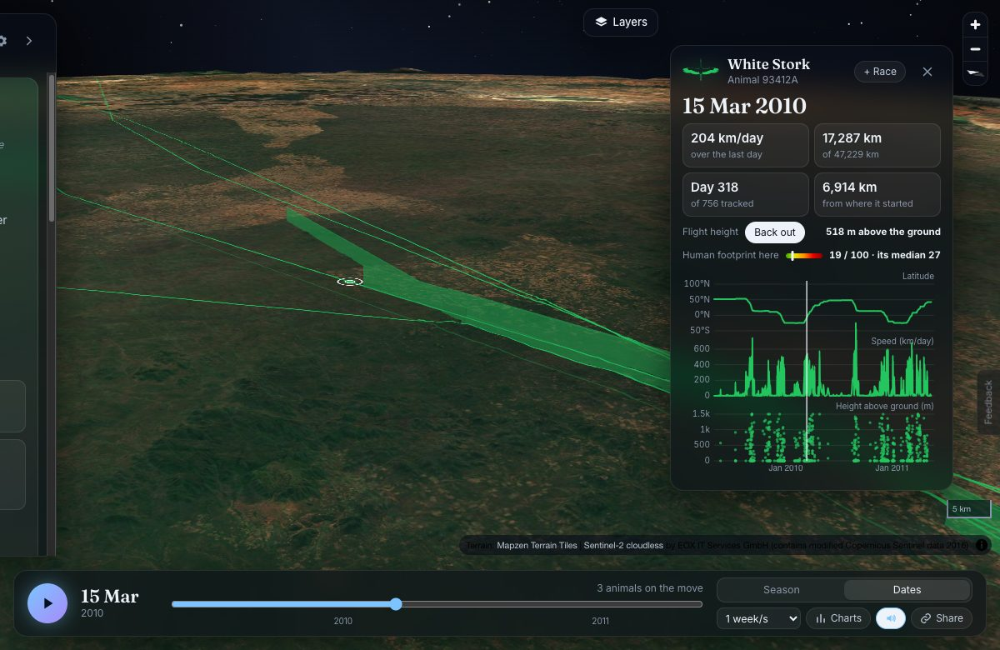
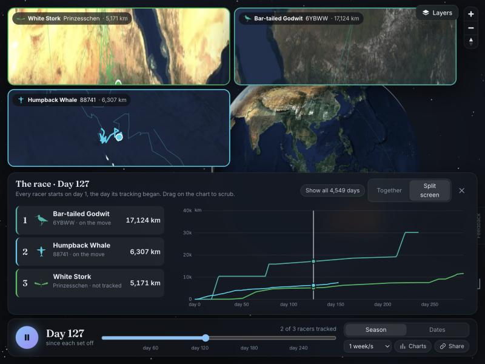
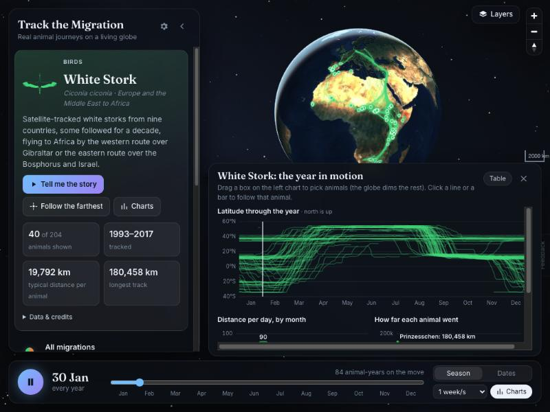
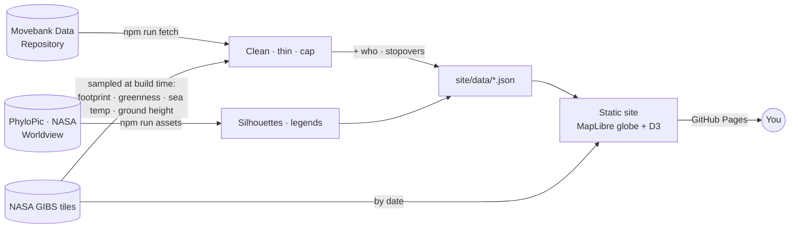

# Track the Migration

Seventeen real animal migrations, from wildebeest, elk and pronghorn to whales, turtles, storks, eagles, vultures, geese, godwits and curlews, replayed on a living 3D globe from published tracking data. In English, Spanish and French. Press **A year on Earth** for a three-minute guided tour of the whole year. Or dig in: see what's migrating this week, read any animal's journey diary, see which seas, deserts and mountains they crossed, find out who passed near your town, see whether birds fly faster with the wind and whether migrations are shifting earlier, print a poster of any journey, browse a journey atlas of every animal, the real conditions each one met along the way, white storks' flight heights in 3D, guided stories, linked charts, live NASA nature and human-impact layers, filters for who each animal is, the places they stopped, a camera that rides along with any animal, races between animals, a "guess where" game, sound you can listen to, full keyboard and screen-reader support, embeds and video export, and links that open at the exact moment you share.

**[Open the live site →](https://amalmehta.github.io/TrackTheMigration/)**

| Ride along with one animal | Guided stories with live NASA layers |
|---|---|
|  |  |

| Where they stopped: white-fronted geese across Arctic Russia | Who they are: ospreys coloured by flyway |
|---|---|
|  |  |

| Journey atlas: every tracked animal, sortable and searchable | A white stork's flight heights in 3D (heights ×6) |
|---|---|
|  |  |

## Links

- [Instructions](docs/INSTRUCTIONS.md): use it, run it locally, refresh the data, add a species
- [System design](docs/SYSTEM-DESIGN.md): how it works, decisions and limits
- [File structure](docs/FILE-STRUCTURE.md): what's where
- Data: [Movebank Data Repository](https://datarepository.movebank.org) · overlays: [NASA GIBS](https://earthdata.nasa.gov/gibs) · silhouettes: [PhyloPic](https://www.phylopic.org). Every source is credited in the app.
