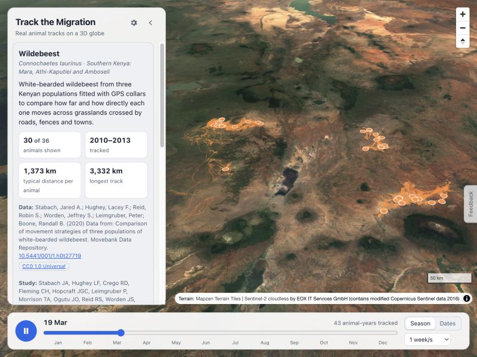
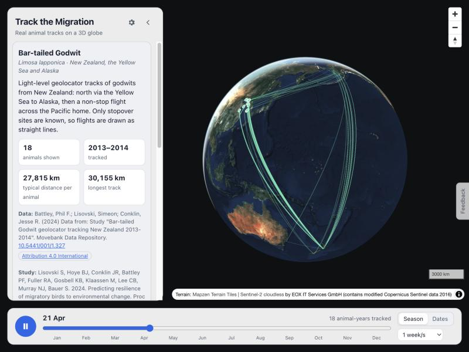
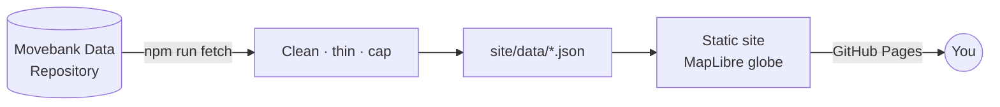

# Track the Migration

Real animal migrations, including wildebeest, zebra, whales, turtles, storks and godwits, replayed on a 3D globe from published GPS and satellite tracking data.

**[Open the live site →](https://amalmehta.github.io/TrackTheMigration/)**

| Wildebeest in Kenya's Rift Valley, in 3D | Bar-tailed godwits: New Zealand → Yellow Sea → Alaska |
|---|---|
|  |  |

## Links

- [Instructions](docs/INSTRUCTIONS.md): use it, run it locally, refresh the data, add a species
- [System design](docs/SYSTEM-DESIGN.md): how it works, decisions and limits
- [File structure](docs/FILE-STRUCTURE.md): what's where
- Data: [Movebank Data Repository](https://datarepository.movebank.org). Every species credits its source on the site
