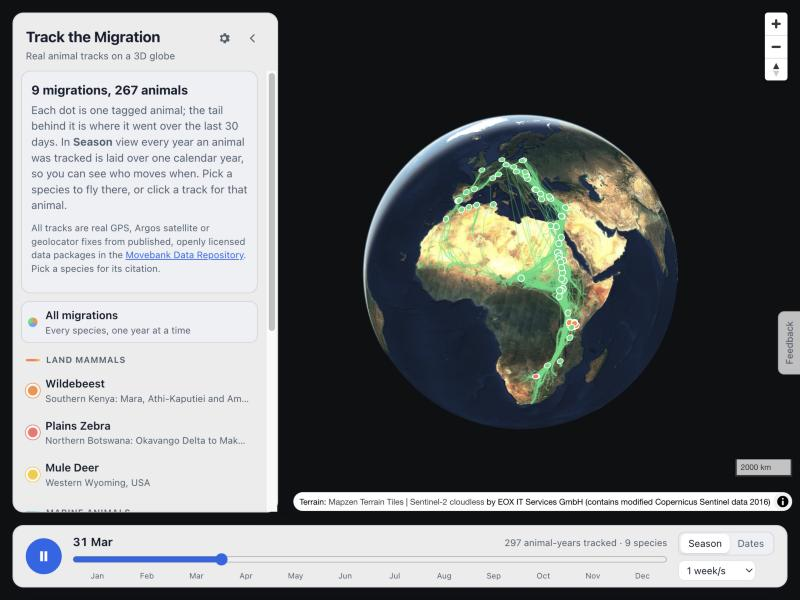
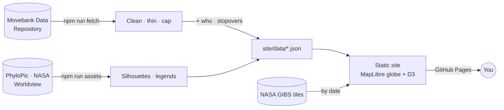

# Track the Migration

Thirteen real animal migrations, from wildebeest, elk and pronghorn to whales, turtles, storks, geese and godwits, replayed on a living 3D globe from published tracking data. It includes guided stories, linked charts, live NASA layers, filters for who each animal is, the places they stopped, a camera that rides along with any animal, and links that open at the exact moment you share.

**[Open the live site →](https://amalmehta.github.io/TrackTheMigration/)**

| Ride along with one animal | Guided stories with live NASA layers |
|---|---|
|  |  |

| Where they stopped: white-fronted geese across Arctic Russia | Who they are: ospreys coloured by flyway |
|---|---|
|  |  |

## Links

- [Instructions](docs/INSTRUCTIONS.md): use it, run it locally, refresh the data, add a species
- [System design](docs/SYSTEM-DESIGN.md): how it works, decisions and limits
- [File structure](docs/FILE-STRUCTURE.md): what's where
- Data: [Movebank Data Repository](https://datarepository.movebank.org) · overlays: [NASA GIBS](https://earthdata.nasa.gov/gibs) · silhouettes: [PhyloPic](https://www.phylopic.org). Every source is credited in the app.
