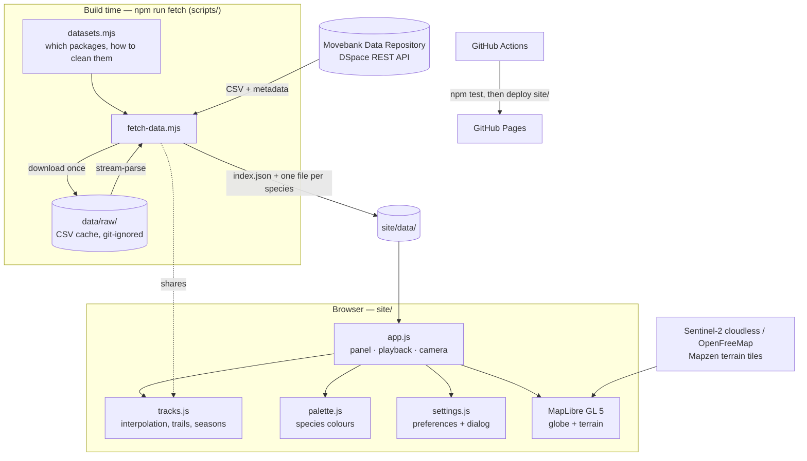

# System Design

Track the Migration is a static website. A Node script turns published animal-tracking datasets into small JSON files. The browser loads those files and animates them on a MapLibre 3D globe. There is no server, database or API key.

## Architecture

## Components

| Component | Job |
|---|---|
| `scripts/datasets.mjs` | The registry of migrations. Each entry has the repository package and file IDs, the one-line description, and the cleaning settings (speed limit, thinning, caps, accepted Argos classes). |
| `scripts/fetch-data.mjs` | Downloads each CSV (cached) and reads the package metadata (authors, DOI, licence, paper). It filters bad fixes, then simplifies and caps each track. It writes `site/data/<id>.json` and `site/data/index.json` with stats and citations. |
| `site/js/tracks.js` | Pure track maths shared by Node and the browser: distance, antimeridian unwrapping, the speed filter, thinning, interpolation, trails, and splitting tracks by calendar year. |
| `site/js/app.js` | Builds the map and layers, renders the species list and info card, runs the playback loop, frames the camera, handles clicks and the feedback tab. |
| `site/js/palette.js` | Species colours in hue families (land: warm, marine: blue, birds: green), with a light and a dark shade for each. |
| `site/js/settings.js` | Preferences with defaults, saved in `localStorage`. Binds the Settings dialog and the ⌘, shortcut. |
| `scripts/serve.mjs` | A dependency-free static server for local use. |
| `.github/workflows/pages.yml` | Runs the tests, then publishes `site/` to GitHub Pages. |

## Main flows

**Building data**

1. For each dataset, download the tracking CSV from `…/server/api/core/bitstreams/<uuid>/content` unless it is already cached.
2. Read the package item for authors, issue date, DOI, licence and the related paper.
3. Stream the CSV line by line. Drop rows marked invisible or as outliers, rows with missing or impossible coordinates, and (for Argos data) location classes other than 3, 2, 1, A or G.
4. Per animal:
   - sort by time
   - apply the speed filter
   - thin to one fix per N hours
   - cap the point count
   - unwrap longitudes across the antimeridian
   - round to about 10 m and 6 minutes
5. Keep the animals with the longest tracks, up to the cap. Write the per-species file and add stats and citation to the index.

Geolocator data (bar-tailed godwit) has one row per stopover with arrival and departure times. Both times become points, so the bird waits at each site and then flies.

**Playback (each animation frame)**

- *Dates mode*: each animal is one instance, and they all share the clock `t`.
- *Season mode*: each animal-year is one instance. Every instance is evaluated at the same fraction of its own year, so all years overlap.
- For each instance, `positionAt` interpolates the head. It returns nothing inside gaps longer than `maxGapHours`, so untracked stretches stay blank. `trailAt` collects the last N days. Heads and trails are written to two GeoJSON sources. Full routes are a third, static source.

**Choosing a species**

1. Load its JSON file. It is cached after the first load, and *All* loads every file.
2. Rebuild the instances and routes, and render the info card.
3. Frame the camera. Zoom comes from `cameraForBounds`. The centre is the bbox centre, and `padding` keeps it out from under the panel and time bar. Land species tilt to 55° to show terrain. Ocean-basin species stay flat at globe zoom.

**Changing settings**

Settings update the shared object, persist it, and notify `app.js`, which applies only what changed. Changing the base map swaps the style. Terrain is switched off first, because MapLibre can't carry a terrain mesh across styles. Terrain, projection and layers come back on `style.load`.

## Where data lives

| Data | Where | Committed? |
|---|---|---|
| Raw CSVs and metadata | `data/raw/` | No (about 300 MB; rebuilt by `npm run fetch`) |
| Processed tracks | `site/data/<species>.json` (6 KB – 1.1 MB each, about 2.8 MB total) | Yes |
| Species list, stats, citations | `site/data/index.json` | Yes |
| Viewer preferences | Browser `localStorage` key `ttm.settings` | n/a |
| Imagery, map and terrain tiles | Third-party tile servers, fetched at runtime | n/a |

## Key decisions and trade-offs

- **Build-time fetch, not live API calls.** The site is fast and works without any API, and an API change can't break it. The source studies are archived and don't change. The cost is that new data means re-running `npm run fetch` and committing.
- **Movebank Data Repository as the only source.** Every package has a DOI, a clear licence (CC0 or CC BY) and a consistent CSV format, so one parser covers all nine species. Some iconic migrations, such as Serengeti wildebeest, Arctic terns and caribou, have no open package there, so they aren't included.
- **Wildebeest are the Kenyan populations.** These are Mara, Athi-Kaputiei and Amboseli. No open-licensed Serengeti-Mara data package was found.
- **MapLibre GL 5 globe with raster-DEM terrain.** This gives a true 3D globe that zooms to valley level. It needs no API key and no build step (loaded from cdnjs). Three.js or globe.gl would look similar zoomed out, but lose detail zoomed in.
- **Key-free tiles.** Imagery is EOX Sentinel-2 cloudless 2016 (CC BY 4.0). Street maps are OpenFreeMap. Terrain is the Mapzen/AWS Terrain Tiles. The cost is depending on their availability and fair-use limits.
- **Thinning and caps.** Each species shows at most 30–40 animals and a bounded number of points. This keeps every file small enough for phones and the frame loop under a millisecond or two. Fine-scale movement is lost.
- **Season view by default.** Overlaying years shows timing ("who moves when") better than raw dates spread over decades. It's labelled clearly, and Dates mode is one click away.
- **Colour by hue family.** Related species share a family, with shades checked for ΔE ≥ 20 in both modes. Track colours follow the map underneath (bright shades on imagery or dark maps), and the list swatches match the map.
- **No framework, no bundler.** The project is plain ES modules, so it's easy to host, read and change.
- **Feedback through GitHub issues.** It needs no backend, and the viewer sees and submits the issue themselves. The cost is that it needs a GitHub account.

## Testing

- `npm test` runs `node:test` unit tests:
  - Track maths: distances, antimeridian unwrapping, speed filter, thinning, caps, binary search, interpolation and gaps, trails, year splitting, and season mapping.
  - The colour rules: every species has a colour, each sits in its group's hue family, every pair has ΔE ≥ 20, and colours contrast with the background, all in both light and dark.
- CI runs the same tests before every deploy.
- Checked by hand in a browser at desktop and 375 px phone sizes:
  - all species load and frame
  - Season and Dates modes, scrubbing, and play/pause
  - settings (theme, base map switch with terrain on, terrain, routes), with no console errors
  - the feedback dialog builds the right issue URL
  - no horizontal scroll on phones

## Known limits

- **Positions are approximate.** Argos fixes can be off by kilometres. Geolocator positions (godwit) are only stopover sites, accurate to around 100–200 km. Lines between fixes are straight, not the animal's real path. Long jumps are drawn as straight lines in the map's projection, not as great circles.
- **Only a sample is shown.** These are the 30–40 longest-tracked animals per species, thinned. The info card says exactly what's shown and links to the full data.
- **Season view mixes years.** Animals tracked in different years appear together, so it shows typical timing, not a single moment.
- **No live tracking.** All studies are archived. Nothing updates on its own.
- **Third-party tiles.** If EOX, OpenFreeMap or the terrain tiles are down, the base map or terrain will be missing, but the tracks still draw.
- **3D terrain is heavy on low-end devices.** It can be switched off in Settings.
