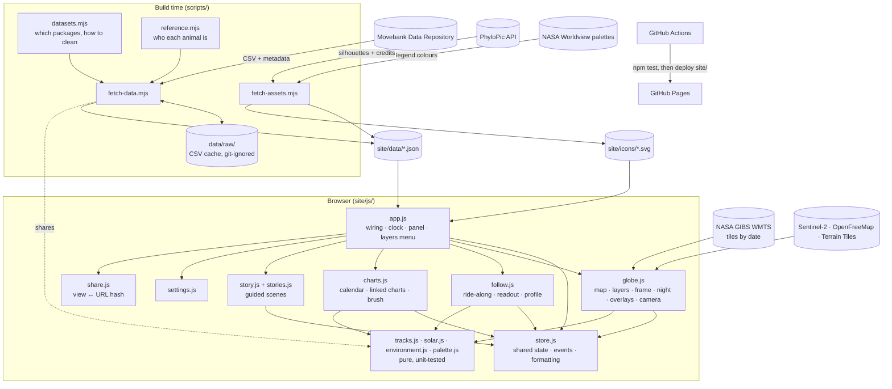

# System Design

Track the Migration is a static website. Build-time scripts turn published animal-tracking datasets, silhouettes and colour palettes into small files under `site/`. The browser loads them and animates them on a MapLibre 3D globe. Charts are drawn with D3, and NASA imagery is streamed live by date. There is no server, database or API key.

## Architecture

## Components

| Component | Job |
|---|---|
| `scripts/datasets.mjs` | The registry of migrations: repository IDs, a one-line description, and cleaning settings (speed limit, thinning, caps, accepted Argos classes, geolocator stopovers). |
| `scripts/fetch-data.mjs` | Downloads each CSV (cached; several files per study allowed) and reads the package metadata. Then: <ul><li>filters bad fixes</li><li>finds each animal's stopovers on the full-resolution cleaned track</li><li>clusters them into shared sites</li><li>simplifies and caps tracks for display</li><li>attaches who-each-animal-is attributes</li></ul> Writes `site/data/<id>.json` and `index.json`. |
| `scripts/reference.mjs` | Turns a study's reference data (one row per deployment) into normalised attributes: sex, age when tagged, tagging site, handling. Keeps only *facets* that split the shown animals into at least two groups of two or more. Tagging sites use the coarsest useful grouping: the site name, then a region in brackets, then the country. |
| `site/js/share.js` | Encodes the current view into the URL hash, and decodes it defensively (bad values ignored). Covers species, Season day or real date, followed animal, story scene, overlay, colour-by, hidden groups and camera. |
| `scripts/fetch-assets.mjs` | Downloads the chosen PhyloPic silhouettes and records their credits and licences. Turns NASA Worldview's palettes into 24-stop legends for the overlays. Writes `assets.json` and `site/icons/`. |
| `site/js/store.js` | Shared state (selection, clock, follow, story, chart selection, hidden groups, colour-by), a tiny event bus, data loading, and formatting helpers. Also holds the who-filter helpers: visibility, and facet shades (dark → light steps of the species hue, grey for unknown). |
| `site/js/globe.js` | Owns the map. Responsibilities: <ul><li>base map and 3D terrain</li><li>seasonal night shading (a canvas source)</li><li>NASA overlays (tiles swapped by date)</li><li>routes, gradient trails with glow, pulsing heads and the focus ring</li><li>the per-frame update and camera framing</li></ul> |
| `site/js/follow.js` | Ride-along mode. The camera eases toward the animal each frame, and pauses when the person drags. The readout shows speed, distance, day, and ground height or distance from start. A two-row D3 journey profile with a playhead can be hovered and scrubbed. |
| `site/js/charts.js` | The charts drawer. <ul><li>All species: a migration calendar heatmap.</li><li>One species: latitude or longitude through the year, with a brush and click-to-follow; distance per day by month; distance per animal, with click-to-follow.</li><li>A table view of the same numbers.</li></ul> |
| `site/js/stories.js` / `story.js` | Story content (scenes with time, camera, overlay and follow) and its player (card, progress, keyboard, and restoring the person's settings afterwards). |
| `site/js/tracks.js` | Track maths shared by Node and the browser. <ul><li>Cleaning: distance, antimeridian unwrap, speed filter, thinning.</li><li>Playback: interpolation, trails, year splitting.</li><li>Analysis: cumulative distance, speed, seasonal movement, main axis of movement.</li></ul> |
| `site/js/solar.js` | Subsolar point, sun altitude, a twilight darkness curve, and a fast night painter with cached per-row and per-column trig. |
| `site/js/environment.js` | NASA overlay definitions, date snapping (monthly or weekly), and moving out-of-archive dates to the nearest covered year. |
| `site/js/palette.js` | Species colours in hue families (land: warm, marine: blue, birds: green), with a light and a dark shade for each. |
| `site/js/settings.js` | Every preference, saved in `localStorage`. Binds the Settings dialog and the ⌘, shortcut. |
| `scripts/serve.mjs`, `.github/workflows/pages.yml` | Local static server; CI that tests, then deploys `site/`. |

## Main flows

**The frame** (each animation frame while playing)

1. The clock advances. In Season view that is a fraction of the year; in Dates view, hours.
2. For every animated instance, `positionAt` interpolates the head, and `trailAt` collects the last N days. An instance is one animal-year in Season view, or one animal in Dates view.
3. Heads and trails go into GeoJSON sources. Trails use `lineMetrics`, so a per-species `line-gradient` fades each tail from transparent to full colour. A blurred copy underneath gives the glow.
4. Night is repainted only when the sun moves noticeably (about 1° of latitude or 6° of view longitude). The overlay's tiles swap only when its snapped date changes, at most every 1.2 s while playing.
5. The follow camera, readout and chart playheads update.

The JavaScript work per frame is about 2 ms for all 645 instances, plus about 6 ms on the occasional night repaint.

**Following an animal**

1. Switch to Dates mode, with the clock range set to that animal's tracking period.
2. Dim every other animal and highlight its route.
3. Fly to it at a zoom and tilt suited to its group.
4. Then ease the camera toward it every frame, unless the person has dragged the map.

On narrower screens the panel tucks away, and the camera padding reserves room for the readout.

**Who-they-are filters**

1. Chips toggle `facet=value` groups in `state.hidden`.
2. Instances, routes, stopover sites and charts are all rebuilt from visible animals only.
3. Colour-by swaps each animal's colour for a shade of its species hue. Trails then draw from a dedicated per-feature-colour layer, because `line-gradient` can't vary by feature. The charts get a legend.

**Stopovers**

- At build time, `findStops` scans each cleaned track for runs of fixes staying within *km* of their running centroid for at least *days*, without crossing a tracking gap. The thresholds are per group, and longitudes are unwrapped so the antimeridian works.
- `clusterStops` merges stops within 2.5 × *km* into sites (longest stops first). Each site carries total animal-days, visits, the animals that used it, and days per month.
- On the globe, rings scale with √days and brighten with the share of that site's use falling in the current month.
- The follow readout checks the animal's own stops to say "staying put · day N of M".

**Share links**

- The hash is rewritten (with `replaceState`, never adding history) 0.6 s after changes and every 2 s while playing.
- On load, a hash is applied before anything else may write. That means:
  1. select the species
  2. restore the overlay and filters
  3. open the story scene, or follow the animal, or set the mode, time and camera
- The view opens paused. A late style load re-frames a followed animal.

**Charts ↔ globe**

- Brushing the latitude chart builds a set of animal keys. `state.highlight` dims everything else on the globe and in the other charts.
- Clicking a line or bar starts following that animal.
- The calendar's cells set the season.

**Stories**

- Each scene sets Season time (`MM-DD`), playback speed and an overlay.
- It then frames the camera in one of three ways: the whole species range, wherever the animals are at that time, or a fixed view.
- The last scene follows the animal that travelled farthest.
- Exiting restores the person's overlay, speed and mode.
- `{placeholders}` (animal count, years, farthest animal and its distance) are computed from the loaded data.

**Night shading**

- The sun's latitude comes from the playback date, so polar day and night are real for the season.
- Its longitude is set 40° east of the view, so the face you're looking at is lit and night curves round the far limb. This is a lighting choice, not the real time of day.
- The canvas source re-reads the canvas, and a paint-property nudge makes 3D terrain redraw its cached drape.

## Where data lives

| Data | Where | Committed? |
|---|---|---|
| Raw CSVs, reference data and metadata | `data/raw/` | No (about 600 MB; `npm run fetch`) |
| Processed tracks, per-animal attributes and stops, stopover sites, facets | `site/data/<species>.json` (about 5 MB total for 13 species) | Yes |
| Species list, stats, citations | `site/data/index.json` | Yes |
| Silhouette credits, overlay legends | `site/data/assets.json`, `site/icons/*.svg` | Yes |
| Story text | `site/js/stories.js` | Yes |
| Viewer preferences | Browser `localStorage` key `ttm.settings` | n/a |
| Imagery, maps, terrain, NASA overlays | Third-party tile servers, fetched at runtime | n/a |

## Key decisions and trade-offs

- **Build-time fetch, not live API calls.** The site stays fast and can't break when an API changes. New data means re-running the scripts.
- **Movebank Data Repository as the only track source.** Every package has a DOI, an open licence and the same CSV shape, including a reference-data file for who each animal is. Iconic migrations without an open package (Serengeti wildebeest, Arctic tern, caribou, sharks) aren't included. The goose study is the 2 MB Alterra one, not the 760 MB LifeTrack geese.
- **Stopovers computed at build time on unthinned tracks.** Thinning to 12–24 h fixes would hide shorter stops. Thresholds are simple distance-and-duration rules per group, which are easy to explain and tune, rather than a behavioural model.
- **Facets only when they split the animals.** A filter that hides nothing, such as "female" when every elk is female, is noise, so it's dropped automatically.
- **Colour-by uses shades of one hue.** Groups within a species stay in that species' colour family, following the colour rule, and are spaced in lightness so they stay distinguishable. "Unknown" is grey.
- **Share state in the hash, not a server.** It works on static hosting, and links stay human-readable. The cost: the overlay in a link becomes the viewer's saved overlay setting.
- **MapLibre GL 5 globe with terrain, plus D3 for charts.** Both load from cdnjs, with no build step. Charts are SVG, which suits brushing, tooltips and a table view.
- **NASA GIBS for live layers.** These are key-free and time-enabled.
  - Layers were chosen for coverage: NDVI monthly (2000 onward), AVHRR-OI sea temperature daily (1981–2020, which covers the 1990s whale data), and snow monthly.
  - Out-of-archive dates use the nearest covered year, and the legend says so.
- **Season view by default.** Overlaying years shows timing better than dates spread over decades. Following an animal switches to real dates, because a single journey is easiest to read in order.
- **Gradient trails per species layer.** `line-gradient` can't be data-driven, so there are 9 trail layers and 9 glow layers, one per species.
- **Night as a mercator canvas** rather than vector polygons. This gives smooth twilight and copes with the poles and the antimeridian. Cost: about 6 ms per repaint, kept rare.
- **Stories hand-written from abstracts, numbers computed live.** Claims stay traceable to the study. Anything quantitative about the tracks shown comes from the data. `tests/stories.test.mjs` checks the structure.
- **Chart colours** use the species hue (one series per chart, so no legend box). The calendar uses a one-hue light-to-dark ramp per row with row labels, so identity never depends on colour alone. Every chart has a table view.
- **Dark theme by default.** It suits the space background and glowing tracks. A full light theme is one setting away.
- **Silhouettes from PhyloPic.** Every image is CC0, public domain or CC BY, and credited on its species card.

## Testing

`npm test` runs 56 `node:test` unit tests, and CI runs the same tests before every deploy.

- **Tracks** (`tracks.test.mjs`): distance, unwrap, speed filter, thinning, caps, search, interpolation and gaps, trails, year splitting, season mapping.
- **Analysis** (`analysis.test.mjs`):
  - cumulative distance, speed over a window, year fraction, seasonal movement, main axis of movement
  - subsolar point at the solstices, sun altitude, the darkness curve, the night canvas
  - NASA date snapping, the nearest-year fallback, tile URLs
- **Stopovers** (in `analysis.test.mjs`): finding a stay, not bridging tracking gaps, merging nearby stops into sites across the antimeridian.
- **Reference** (`reference.test.mjs`): sex, age and handling normalisation; site grouping (osprey regions, stork countries); facets kept only when they split the animals.
- **Share** (`share.test.mjs`): decoding dates, Season days, camera, colour-by and hidden groups; rejecting bad values; busiest-month ranges wrapping the new year.
- **Palette** (`palette.test.mjs`): all 13 species. Covers hue families, pairwise ΔE ≥ 20 (the shades were found by search; the smallest pair is 21.9) and contrast against the background, in light and dark.
- **Stories** (`stories.test.mjs`): one per species, 4–6 scenes, valid dates, views, overlays and placeholders, each ending in a ride-along.

Checked by hand in a browser, at desktop, 800 px and 375 px phone sizes, with no console errors:

- All View: the starfield, glow and night shading.
- Species: fly-to framing with the panel, charts and readout open.
- Follow mode: the camera ride, readout values (ground height checked against Amboseli's real ~1,150 m), profile hover and scrub, Esc.
- Charts:
  - the calendar
  - the brush highlighting the same animals on the globe
  - click-to-follow and the table view
- Stories: scenes, overlay switching, and settings restored on exit.
- Overlays: legend dates, and the nearest-year note.
- Themes: light and dark.
- Phone: bottom-sheet layout, no horizontal scroll.

## Known limits

- **Positions are approximate.** Argos fixes can be off by kilometres. Geolocator positions (godwit) are only stopovers, accurate to around 100–200 km. Lines between fixes are straight, not the real path, and long jumps are drawn straight in the map's projection rather than as great circles.
- **Only a sample is shown.** These are the 30–40 longest-tracked animals per species, thinned. Speeds in the readout and charts come from these thinned fixes, so short bursts are smoothed out.
- **Season view mixes years.** Animals tracked in different years appear together.
- **Night shading is seasonal, not clock time.** The sun's longitude follows the view, by design.
- **Overlays may show a different year** when the animals' own year isn't in NASA's archive (the legend says so). Monthly layers change only once a month.
- **No live tracking.** All studies are archived.
- **Third-party tiles.** If EOX, OpenFreeMap, the terrain tiles or NASA GIBS are down, that layer is missing, but tracks and charts still work.
- **Stopovers depend on thresholds.** A bird circling a lake for 2 days isn't a stop; a whale foraging within 40 km for a week is. The rings describe where animals lingered, not why.
- **Facets are only as good as the reference data.** Many blue whales and storks have unknown sex. Stork "tagged at" has too many sites to group well, so it isn't shown.
- **Share links carry the overlay into your settings.** Opening a link with an overlay switches that overlay on for you.
- **Heavier on low-end devices.** 3D terrain, glow and night shading can each be switched off.
