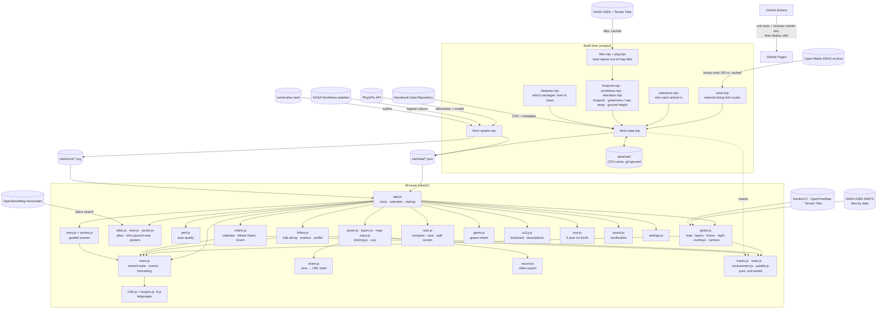

# System Design

Track the Migration is a static website. Build-time scripts turn published animal-tracking datasets, silhouettes and colour palettes into small files under `site/`. The browser loads them and animates them on a MapLibre 3D globe. Charts are drawn with D3, and NASA imagery is streamed live by date. There is no server, database or API key.

## Architecture

## Components

| Component | Job |
|---|---|
| `scripts/datasets.mjs` | The registry of migrations: repository IDs, a one-line description, and cleaning settings (speed limit, thinning, caps, accepted Argos classes, geolocator stopovers). |
| `scripts/fetch-data.mjs` | Downloads each CSV (cached; several files per study allowed) and reads the package metadata. Then: <ul><li>filters bad fixes</li><li>finds each animal's stopovers on the full-resolution cleaned track</li><li>clusters them into shared sites</li><li>simplifies and caps tracks for display</li><li>attaches who-each-animal-is attributes</li></ul> Writes `site/data/<id>.json` and `index.json`. |
| `scripts/reference.mjs` | Turns a study's reference data (one row per deployment) into normalised attributes: sex, age when tagged, tagging site, handling. Keeps only *facets* that split the shown animals into at least two groups of two or more. Tagging sites use the coarsest useful grouping: the site name, then a region in brackets, then the country. |
| `scripts/footprint.mjs` | Samples the Human Footprint index (SEDAC 1995–2004, via NASA GIBS tiles at zoom 7, ~1.2 km) under every displayed fix of land animals and birds. Each palette pixel is matched to NASA Worldview's colour map to recover its value. Produces per-fix values, per-animal summaries and a species summary. Tiles are cached. |
| `scripts/tiles.mjs` | The shared build-time tile sampler. Fetches and caches the 256-px Web-Mercator tiles under a set of points (optionally per date), decodes them, and turns each point's pixel into a number: through a NASA palette's colour table, or as Terrarium elevation. |
| `scripts/conditions.mjs` | The conditions each animal met: vegetation greenness (NDVI, monthly, zoom 7) under every displayed fix of land animals, and sea surface temperature (daily, snapped to the 1st or 15th, zoom 4) under marine animals. Uses the same date snapping and nearest-year fallback as the live overlays. |
| `scripts/elevation.mjs` | Ground height (AWS Terrain Tiles, zoom 10) under a bird's in-flight GPS fixes, so flight height = GPS height − ground. |
| `scripts/wind.mjs` | Wind along bird routes. For every step a bird was travelling (faster than 4 km/h over the step, at most two weeks long; long geolocator flights get one sample a day along the line), the hourly ERA5 wind 100 m above the ground at the step's midpoint and time, split into tailwind and crosswind along the bird's heading. Requests group many places per date, are cached in `data/raw/wind/`, wait out per-minute and hourly limits, and stop for the day at the daily limit so a later run finishes the job. |
| `scripts/i18n-keys.mjs`, `scripts/i18n-add.mjs` | Collect every English string the site can show (from `t()` calls, the page, and the data) and report what each language is missing; add or update translations. |
| `scripts/topojson.mjs` | Decodes a TopoJSON object into rings; used for the land outline behind the atlas maps. |
| `scripts/smoke.mjs` | The browser smoke test: serves `site/`, drives headless Chrome over the DevTools protocol and walks the main flows (home, species and charts, follow with conditions, a shared stork link with flight height and 3D, a story, the atlas, the tour, embed, phone layout). Any uncaught exception or console error fails it. |
| `scripts/png.mjs` | A dependency-free PNG decoder (8-bit, non-interlaced: palette, grey, RGB, RGBA), using Node's zlib plus the five row filters. |
| `site/js/atlas.js` | The journey atlas: a card per tracked animal with a small canvas map (equirectangular fit, land from `land.json`, the route fading in from its start). Cards draw lazily as they scroll into view; hovering replays the journey; clicking follows it. Filters by species and "who" group, sorts by distance, duration, footprint or date, and searches by name. |
| `site/js/near.js` | Who passed near. Place search through OpenStreetMap Nominatim (one request per search), or the browser's location rounded to ~10 km and never put in the link. The overview shortlists species with a wide margin, then each candidate's full tracks give exact passes (`passesNear`: closest approach along each straight line between fixes, not across tracking gaps, split into visits after 14 days away). Clicking a pass jumps, paused, to that moment and follows the animal. A searched place is shareable (`#near=lon,lat,km&nm=name`). |
| `site/js/poster.js` | Journey posters: a 2400 × 3200 PNG of one animal's journey drawn on a canvas: route coloured from start to end (tracking gaps dashed), stopovers sized by days, start and end labels, four key numbers, a latitude strip and full credits. |
| `site/js/perf.js` | Auto quality. While the globe is moving or playing it times frames in 2-second windows (after a 10-second warm-up). Two slow windows (< 28 fps) step detail down: no glow → sharpness 1× and 30-day trails → no terrain or night shading and 14-day trails. Eight fast windows step back up, unless a step up had to be undone. It only lowers what's drawn, through `globe.quality`; settings are untouched. An optional frame-rate meter. |
| `site/js/i18n.js`, `site/js/lang/` | Languages. `t('English text', vars)` looks the text up in the chosen language's dictionary (Spanish, French), or returns the English. Dates and numbers use each language's conventions. Static page text is translated on load; species, groups, stories and layer text are translated once after data loads. The language comes from the browser unless chosen in Settings; changing it reloads the page. |
| `site/js/land.js` | The land outline, loaded once, shared by the atlas and posters. |
| `site/js/panel.js` | The side panel: the species list, the info card for the selection, and "who they are" (filter chips, colour-by, stopover summary). |
| `site/js/layers.js` | The Layers popover (basemap, overlay, terrain, effects) and the overlay legend. |
| `site/js/map-input.js` | Pointer input on the globe: hover tips, click to follow, shift-click to race, stopover-site tips and picking. |
| `site/js/sharing.js` | Keeping the address bar's link in step with the view and applying a shared link on load; the Share menu (link, embed code, video recording); embed mode. |
| `site/js/ui.js` | The toast, button icons, the feedback tab and the starfield. |
| `site/js/race.js` | The compare tray and races. <ul><li>Racers replay from their own day 1 (`instanceTime` = start + day).</li><li>The leaderboard has statuses (moving, staying put, untracked, tag ended), and there's a distance-over-time chart with a scrubbing crosshair.</li><li>The race is sized to the field when one track is much longer.</li><li>Split screen creates one lightweight MapLibre globe per racer.</li></ul> |
| `site/js/game.js` | Guess where. <ul><li>Picks random real moments with a meaningful 30-day move (land ≥ 12 km, marine ≥ 150 km, birds ≥ 250 km).</li><li>Hides routes, stopovers and the time bar so nothing gives the answer away.</li><li>Plays the answer forward and scores `1000·exp(−miss / max(25 km, move/2))`.</li></ul> |
| `site/js/record.js` | Video export. Each frame it composites the map canvas (kept readable with `preserveDrawingBuffer`) with captions onto a 2D canvas. `MediaRecorder` turns that into WebM (or MP4 in Safari), stopped by a wall-clock timer. |
| `site/js/a11y.js` | Plain-language descriptions, sent to a polite live region and the map's label. <ul><li>Per species: the animals tracked now, and the mean direction and speed of their last week (from `recentHeading` and `compassWord`), or "in different directions" when headings disagree.</li><li>A follow mode summary.</li><li>Race standings.</li></ul> Keyboard: step the clock, cycle on-screen animals with a focus ring, follow, race, describe, open charts and layers, and a shortcuts dialog. |
| `site/js/tour.js` | A year on Earth. Season view at 2 days/s. Every 18 days a director scores each species: <ul><li>activity in this half-month, scaled by how vigorous that species is for its group</li><li>plus a story scene within 30 days</li><li>minus recently or often shown</li></ul> It then frames the winner's current positions, dims the rest, and captions with that scene's text. It ends when the year wraps, and loops in embeds. |
| `site/js/sound.js` | Web Audio sonification. One voice per visible species (oscillators, a low-pass filter, gain), into a compressor and a generated reverb. Every 150 ms, pitch is set from the mean latitude (pentatonic, register by group) and gain from the mean 3-day speed relative to the group. |
| `site/js/share.js` | Encodes the current view into the URL hash, and decodes it defensively (bad values ignored). Covers species, Season day or real date, followed animal, story scene, overlay, colour-by, hidden groups and camera. |
| `scripts/fetch-assets.mjs` | Downloads the chosen PhyloPic silhouettes and records their credits and licences. Turns NASA Worldview's palettes into 24-stop legends for the overlays. Writes `assets.json` and `site/icons/`. |
| `site/js/store.js` | Shared state (selection, clock, follow, story, chart selection, hidden groups, colour-by), a tiny event bus, data loading, and formatting helpers. Also holds the who-filter helpers: visibility, and facet shades (dark → light steps of the species hue, grey for unknown). |
| `site/js/globe.js` | Owns the map. Responsibilities: <ul><li>base map and 3D terrain</li><li>the flight-height curtain: extruded walls under a followed bird's in-flight fixes</li><li>seasonal night shading (a canvas source)</li><li>NASA overlays (tiles swapped by date)</li><li>routes, gradient trails with glow, pulsing heads and the focus ring</li><li>the per-frame update and camera framing</li></ul> |
| `site/js/follow.js` | Ride-along mode. The camera eases toward the animal each frame, and pauses when the person drags. The readout shows speed, distance, day, ground height or distance from start, the human footprint, and the conditions here (greenness or sea temperature) or, for storks with GPS heights, the flight height. A D3 journey profile with a playhead can be hovered and scrubbed: latitude, speed, and a third row for conditions or flight height. "See it in 3D" dives the camera in close to the flight-height curtain. |
| `site/js/charts.js` | The charts drawer. <ul><li>All species: a migration calendar heatmap.</li><li>One species: latitude or longitude through the year, with a brush and click-to-follow; distance per day by month; distance per animal, with click-to-follow; human footprint; greenness or sea temperature by month (median and middle half).</li><li>A table view of the same numbers.</li></ul> |
| `site/js/stories.js` / `story.js` | Story content (scenes with time, camera, overlay and follow) and its player (card, progress, keyboard, and restoring the person's settings afterwards). |
| `site/js/tracks.js` | Track maths shared by Node and the browser. <ul><li>Cleaning: distance, antimeridian unwrap, speed filter, thinning.</li><li>Playback: interpolation, trails, year splitting.</li><li>Analysis: cumulative distance, speed, seasonal movement, main axis of movement.</li></ul> |
| `site/js/solar.js` | Subsolar point, sun altitude, a twilight darkness curve, and a fast night painter with cached per-row and per-column trig. |
| `site/js/environment.js` | NASA overlay definitions, date snapping (monthly or weekly), and moving out-of-archive dates to the nearest covered year. |
| `site/js/palette.js` | Species colours in hue families (land: warm, marine: blue, birds: green), with a light and a dark shade for each. |
| `site/js/settings.js` | Every preference, saved in `localStorage`. Binds the Settings dialog and the ⌘, shortcut. |
| `scripts/serve.mjs`, `.github/workflows/pages.yml` | Local static server (also used by the smoke test); CI that runs the unit tests and the browser smoke test, then deploys `site/`. |

## Main flows

**The frame** (each animation frame while playing)

1. The clock advances. In Season view that is a fraction of the year; in Dates view, hours.
2. For every animated instance, `positionAt` interpolates the head, and `trailAt` collects the last N days. An instance is one animal-year in Season view, or one animal in Dates view.
3. Heads and trails go into GeoJSON sources. Trails use `lineMetrics`, so a per-species `line-gradient` fades each tail from transparent to full colour. A blurred copy underneath gives the glow.
4. Night is repainted only when the sun moves noticeably (about 1° of latitude or 6° of view longitude). The overlay's tiles swap only when its snapped date changes, at most every 1.2 s while playing.
5. The follow camera, readout and chart playheads update.

The JavaScript work per frame is about 2 ms for all 645 instances, plus about 6 ms on the occasional night repaint.

**Following an animal**

1. Switch to Dates mode, with the clock range set to that animal's tracking period.
2. Dim every other animal and highlight its route.
3. Fly to it at a zoom and tilt suited to its group.
4. Then ease the camera toward it every frame, unless the person has dragged the map.

On narrower screens the panel tucks away, and the camera padding reserves room for the readout.

**Conditions along the route** (build time)

1. For each displayed fix, pick the overlay date it falls in (`overlayDate`, the same rule as the live layers). Sea temperature is coarsened to the 1st or 15th of the month to keep the tile count sane.
2. Group fixes by tile and date, fetch and cache each tile once, decode the palette PNG, and map each pixel's colour back to a value with NASA Worldview's colour table.
3. Store one rounded number per fix (`cond`, with `condKey` saying which layer). The readout, profile and monthly chart read these directly.

**Flight height** (build time and in the browser)

1. The stork study's GPS file has a height for many fixes. Only fixes taken in flight are kept: both ends of each step at most 2 h apart and faster than 15 km/h (`flightFixes`). That keeps whole flights, so they can be drawn as continuous walls.
2. The ground height under each one (Terrain Tiles, zoom 10) is subtracted to give height above the ground.
3. Following such a bird shows the nearest in-flight height within 3 h, and draws every flight as a thin `fill-extrusion` wall. "See it in 3D" pauses, jumps to the next flight if needed, and dives to zoom 9.5 at a steep tilt. Walls are 6× taller than life, otherwise they'd be a few pixels high.

**The journey atlas**

1. Built from the overview file (≤ 180 points per animal) plus the `attrs`, `hfMedian` and `flies` fields written into it, so it needs no species files.
2. Cards are created at once, but their canvases draw only as they scroll near view (`IntersectionObserver`). Land is drawn from a 110 m outline, with shifted copies across the antimeridian.

**Wind along the way** (build time) and **Faster with the wind?**

1. `travelSteps` picks the steps a bird was travelling; `windSampler` fetches (or reads from cache) the hourly wind at 100 m for each step's midpoint and hour, on ERA5's 0.25° grid.
2. `windComponents` turns wind speed and direction into tailwind (positive helps) and crosswind relative to the step's heading.
3. Each step is stored as `[start, end, tailwind, crosswind, ground speed km/day]`. The readout shows the wind for the step the bird is on; the journey profile draws one bar per step; the species chart compares median travel speed across six wind bands.

**Then vs now**

1. For each animal, the halfway line of its range is the midpoint of the 10th and 90th percentiles along the species' main axis (needs ≥ 4° of range, so land herds that barely migrate are skipped).
2. A crossing counts only if the animal then stays on the new side for 10 days, and isn't across a tracking gap.
3. Crossings are grouped by direction and placed by year and by days from that direction's circular-mean date. A least-squares slope gives "days earlier or later per decade" once there are 8 or more crossings in 3 or more years; otherwise the chart says too few.

**Who-they-are filters**

1. Chips toggle `facet=value` groups in `state.hidden`.
2. Instances, routes, stopover sites and charts are all rebuilt from visible animals only.
3. Colour-by swaps each animal's colour for a shade of its species hue. Trails then draw from a dedicated per-feature-colour layer, because `line-gradient` can't vary by feature. The charts get a legend.

**Stopovers**

- At build time, `findStops` scans each cleaned track for runs of fixes staying within *km* of their running centroid for at least *days*, without crossing a tracking gap. The thresholds are per group, and longitudes are unwrapped so the antimeridian works.
- `clusterStops` merges stops within 2.5 × *km* into sites (longest stops first). Each site carries total animal-days, visits, the animals that used it, and days per month.
- On the globe, rings scale with √days and brighten with the share of that site's use falling in the current month.
- The follow readout checks the animal's own stops to say "staying put · day N of M".

**Share links**

- The hash is rewritten (with `replaceState`, never adding history) 0.6 s after changes and every 2 s while playing.
- On load, a hash is applied before anything else may write. That means:
  1. select the species
  2. restore the overlay and filters
  3. open the story scene, or follow the animal, or set the mode, time and camera
- The view opens paused. A late style load re-frames a followed animal.

**Loading**

- The All migrations view loads `index.json`, `assets.json` and `overview.json`: every species at ≤ 180 points per animal, plus the top 15 sites.
- A species' full file (all points, footprint values, stops, facets) loads only when it's opened, followed, raced or used in the game.
- `viewData()` gives the right one for the current view. `fullAnimal()` swaps a light copy for the full track when you follow or race from the All view.
- In headless Chrome the first frame's data arrived in about 1.9 s, against 7.7 s when every full file loaded.

**Races**

- Racers come from the compare tray, which is filled by shift-clicking or "+ Race". Starting a race replaces the normal instances with one per racer, coloured by species, or by shades of a species when it races itself.
- The clock is `race.day`, and each racer's time is its start + day.
- Routes show only the racers; stopovers and Season logic are off. Ending the race restores the normal view.

**Guess where**

- `state.only` limits the globe to one animal and turns off its route.
- The camera frames a window sized to how far that animal moved in the month.
- A guess is a map click. Locking it in animates 30 days of real time, then draws the guess, the real position and the miss between them.

**Embed and video**

- `?embed=1` adds a body class that hides everything but the globe and clock, and shows a link back to the full site at the same hash. Embedded globes autoplay.
- The share menu builds the `<iframe>` snippet from the live hash.

**Charts ↔ globe**

- Brushing the latitude chart builds a set of animal keys. `state.highlight` dims everything else on the globe and in the other charts.
- Clicking a line or bar starts following that animal.
- The calendar's cells set the season.

**Stories**

- Each scene sets Season time (`MM-DD`), playback speed and an overlay.
- It then frames the camera in one of three ways: the whole species range, wherever the animals are at that time, or a fixed view.
- The last scene follows the animal that travelled farthest.
- Exiting restores the person's overlay, speed and mode.
- `{placeholders}` (animal count, years, farthest animal and its distance) are computed from the loaded data.

**Night shading**

- The sun's latitude comes from the playback date, so polar day and night are real for the season.
- Its longitude is set 40° east of the view, so the face you're looking at is lit and night curves round the far limb. This is a lighting choice, not the real time of day.
- The canvas source re-reads the canvas, and a paint-property nudge makes 3D terrain redraw its cached drape.

## Where data lives

| Data | Where | Committed? |
|---|---|---|
| Raw CSVs, reference data and metadata, tile caches | `data/raw/` | No (about 690 MB; `npm run fetch`) |
| Light all-species copy for the All view and the atlas | `site/data/overview.json` (≈ 1.2 MB, ≈ 0.36 MB gzipped) | Yes |
| Processed tracks, per-animal attributes and stops, stopover sites, facets | `site/data/<species>.json` (about 6.6 MB total for 13 species) | Yes |
| Species list, stats, citations | `site/data/index.json` | Yes |
| Silhouette credits, overlay legends | `site/data/assets.json`, `site/icons/*.svg` | Yes |
| Human Footprint per fix (land and birds) | `hf` arrays in `site/data/<species>.json`; tile cache in `data/raw/hf/` | Data yes, tiles no |
| Greenness or sea temperature per fix | `cond` arrays and `condKey` in `site/data/<species>.json`; tiles in `data/raw/gibs/` | Data yes, tiles no |
| In-flight heights (two white storks) | `alt` arrays `[hours, lon, lat, m above sea, m above ground]`; ground tiles in `data/raw/dem/` | Data yes, tiles no |
| Land outline for the atlas | `site/data/land.json` (from world-atlas 110 m, rounded to 0.1°) | Yes |
| Wind per travelling step (birds) | `wind` arrays in bird species files; cache `data/raw/wind/cache.json` | Data yes, cache no |
| Translations | `site/js/lang/es.js`, `site/js/lang/fr.js` (keyed by the English text) | Yes |
| Story text | `site/js/stories.js` | Yes |
| Viewer preferences | Browser `localStorage` key `ttm.settings` | n/a |
| Imagery, maps, terrain, NASA overlays | Third-party tile servers, fetched at runtime | n/a |

## Key decisions and trade-offs

- **Build-time fetch, not live API calls.** The site stays fast and can't break when an API changes. New data means re-running the scripts.
- **Movebank Data Repository as the only track source.** Every package has a DOI, an open licence and the same CSV shape, including a reference-data file for who each animal is. Iconic migrations without an open package (Serengeti wildebeest, Arctic tern, caribou, sharks) aren't included. The goose study is the 2 MB Alterra one, not the 760 MB LifeTrack geese.
- **Stopovers computed at build time on unthinned tracks.** Thinning to 12–24 h fixes would hide shorter stops. Thresholds are simple distance-and-duration rules per group, which are easy to explain and tune, rather than a behavioural model.
- **Facets only when they split the animals.** A filter that hides nothing, such as "female" when every elk is female, is noise, so it's dropped automatically.
- **Colour-by uses shades of one hue.** Groups within a species stay in that species' colour family, following the colour rule, and are spaced in lightness so they stay distinguishable. "Unknown" is grey.
- **Footprint sampled at build time, not in the browser.** Each fix gets one integer, so the readout and charts need no tile reads at runtime. The cost is about 0.5 MB more data, and a snapshot from 1995–2004 rather than the animals' own year.
- **People overlays are the ones GIBS serves without a key**: Human Footprint, GPW population density and Black Marble night lights. Protected-area boundaries (WDPA) aren't available that way, so they're not included.
- **Races align journeys by their own start.** That's what makes animals tracked decades apart comparable. Split screen uses separate small maps rather than one map with several cameras, which MapLibre doesn't support; each is light (no terrain or overlays).
- **The game scores relative to the move**, so species with very different scales are equally fair. Rounds are random, with repeats avoided within a game.
- **Video is recorded in the browser** with `MediaRecorder` on a composited canvas, so captions are burned in and nothing is uploaded. WebM is preferred because Chrome's MP4 recorder produced empty files in testing.
- **Animal data updates at most 30 times a second** while the camera renders every frame, which halves the per-frame data work.
- **An overview file instead of every species up front.** The All view needs shapes and timing, not every fix, so the first load is about five times smaller. The cost is a second small download when you open a species.
- **Descriptions are computed, not written.** Direction and speed come from the tracks, so they're always true for the moment you're on. They're spoken on pause and on demand, not continuously, so a screen reader isn't flooded.
- **The tour director is a simple, explainable score** rather than a script, so it adapts to all 13 species and any future ones. In testing it showed all 13 in one year, none more than three times.
- **Sound stays consonant on purpose.** Notes are snapped to a pentatonic scale and spread across registers by group, so 13 voices blend instead of clashing. It's off by default.
- **Conditions sampled at build time, from the same NASA layers as the overlays.** The readout and charts then agree with what the overlay shows, and the browser reads no tiles for them. One layer per group keeps it readable: greenness for land animals, sea temperature for marine ones. Birds get flight height instead, as it's what the GPS data adds for them.
- **Flight heights only from in-flight fixes.** Spreading 1,500 height fixes evenly over years left them 8 h apart, with no flight continuous enough to draw. Keeping whole flights shows real ones. Only two storks were sampled often enough (1–2 h apart) to qualify, and the app says "not flying right now" between flights rather than guessing.
- **Exaggerated walls, labelled as such.** True-scale walls would be a few pixels tall at any zoom that shows the route, so they're 6× taller, and the button's tooltip says so. The numbers in the readout and profile are real.
- **The atlas draws with canvas, not more maps.** 368 small MapLibre maps would be far too heavy, so each card is a plain 2D canvas, drawn only when it scrolls into view.
- **A browser smoke test in CI**, written against the DevTools protocol with no dependencies, so a broken page can't deploy. It runs with software rendering on the CI runner, which is slow but needs no GPU.
- **Four more species, chosen for new places.** Steppe eagle (Central Asia to Arabia and East Africa), Egyptian vulture (Middle East to the Horn of Africa), turkey vulture (two continents, including South America) and far eastern curlew (Australia to north-east Asia) were the strongest open, GPS-tracked studies found; caribou were rejected because the open data barely moves on a map.
- **Seventeen bird-and-mammal colours still pass the rules.** Nine birds in one green family needed a fresh search, with limits on lightness and saturation so no colour is neon or near-black; the smallest difference is ΔE 31 (light) and 35 (dark).
- **Wind at 100 m, labelled as such.** The key-free ERA5 archive has 10 m and 100 m wind but no upper-air levels, so it's the wind near the ground, not necessarily where birds fly. It still shows the steppe-eagle study's point (tailwinds speed birds up) and is stated plainly in the chart.
- **Timing by the halfway crossing, not departure.** Departure dates need species-specific rules; the date an animal crosses the middle of its own range works for any species and resists wandering. The chart is cautious by design: different animals in different years, trend only with enough data.
- **Who passed near uses the full tracks, after a cheap shortlist.** The overview (≤ 180 points per animal) can miss a pass, so it only picks which species to load; exact passes come from every point. Lines between fixes are checked, not just the fixes, so a stork flying straight over a town counts.
- **Location privacy.** "Use my location" rounds to about 10 km, runs entirely in the browser and is never written into the link; only a searched place name can be shared.
- **Posters on a canvas, not the map.** A clean, print-style drawing at fixed size, independent of the screen, with no tile licensing questions; satellite imagery isn't needed to read a journey.
- **Auto quality lowers drawing, never settings.** On a slow device the glow, sharpness, trail length, terrain and night shading step down in that order, and back up when there's headroom. Choosing "Always full detail" turns it off.
- **Translations keyed by the English text.** Code stays readable (`t('A year on Earth')`), a missing translation falls back to English, and a test fails if any string the site can show lacks a Spanish or French version or loses a `{placeholder}` or HTML tag. Gendered sentences ("this white stork") were reworded to use the animal's name.
- **Share state in the hash, not a server.** It works on static hosting, and links stay human-readable. The cost: the overlay in a link becomes the viewer's saved overlay setting.
- **MapLibre GL 5 globe with terrain, plus D3 for charts.** Both load from cdnjs, with no build step. Charts are SVG, which suits brushing, tooltips and a table view.
- **NASA GIBS for live layers.** These are key-free and time-enabled.
  - Layers were chosen for coverage: NDVI monthly (2000 onward), AVHRR-OI sea temperature daily (1981–2020, which covers the 1990s whale data), and snow monthly.
  - Out-of-archive dates use the nearest covered year, and the legend says so.
- **Season view by default.** Overlaying years shows timing better than dates spread over decades. Following an animal switches to real dates, because a single journey is easiest to read in order.
- **Gradient trails per species layer.** `line-gradient` can't be data-driven, so there are 9 trail layers and 9 glow layers, one per species.
- **Night as a mercator canvas** rather than vector polygons. This gives smooth twilight and copes with the poles and the antimeridian. Cost: about 6 ms per repaint, kept rare.
- **Stories hand-written from abstracts, numbers computed live.** Claims stay traceable to the study. Anything quantitative about the tracks shown comes from the data. `tests/stories.test.mjs` checks the structure.
- **Chart colours** use the species hue (one series per chart, so no legend box). The calendar uses a one-hue light-to-dark ramp per row with row labels, so identity never depends on colour alone. Every chart has a table view.
- **Dark theme by default.** It suits the space background and glowing tracks. A full light theme is one setting away.
- **Silhouettes from PhyloPic.** Every image is CC0, public domain or CC BY, and credited on its species card.

## Testing

`npm test` runs the `node:test` unit tests (91 at last count). `npm run smoke` runs the browser smoke test (14 flows in headless Chrome). CI runs both before every deploy.

- **Tracks** (`tracks.test.mjs`): distance, unwrap, speed filter, thinning, caps, search, interpolation and gaps, trails, year splitting, season mapping, in-flight fixes (fast, closely spaced steps; trimming by whole flights).
- **Tiles** (`tiles.test.mjs`): Web-Mercator pixels, palette colour tables, paletted and Terrarium decoding.
- **Passes, timing** (in `tracks.test.mjs`): closest approach between fixes, separate visits, gaps not bridged, the antimeridian; halfway crossings ignoring jitter and needing range; slope.
- **Wind** (`wind.test.mjs`): tail and cross components; travel steps skip resting and sample long flights daily.
- **Languages** (`i18n.test.mjs`): Spanish and French cover every string the site can show, with the same `{placeholders}` and HTML tags.
- **TopoJSON** (`topojson.test.mjs`): arc decoding and rings.
- **Analysis** (`analysis.test.mjs`):
  - cumulative distance, speed over a window, year fraction, seasonal movement, main axis of movement
  - subsolar point at the solstices, sun altitude, the darkness curve, the night canvas
  - NASA date snapping, the nearest-year fallback, tile URLs
- **Stopovers** (in `analysis.test.mjs`): finding a stay, not bridging tracking gaps, merging nearby stops into sites across the antimeridian.
- **Reference** (`reference.test.mjs`): sex, age and handling normalisation; site grouping (osprey regions, stork countries); facets kept only when they split the animals.
- **Share** (`share.test.mjs`): decoding dates, Season days, camera, colour-by and hidden groups; rejecting bad values (impossible dates, non-numeric scenes); busiest-month ranges wrapping the new year.
- **PNG and footprint** (`png.test.mjs`): paletted and RGB decoding with sub, up and Paeth filters; rejecting non-PNGs; Web-Mercator pixel maths; footprint summaries and bands.
- **Descriptions and sound** (in `analysis.test.mjs`): bearings, compass words and recent heading; latitude → pentatonic pitch by group; speed → level.
- **People overlays** (in `analysis.test.mjs`): nearest census or lights year, the fixed footprint snapshot, URLs without a time dimension.
- **Palette** (`palette.test.mjs`): all 13 species. Covers hue families, pairwise ΔE ≥ 20 (the shades were found by search; the smallest pair is 21.9) and contrast against the background, in light and dark.
- **Stories** (`stories.test.mjs`): one per species, 4–6 scenes, valid dates, views, overlays and placeholders, each ending in a ride-along.

Checked by hand in headless Chrome for v7:

- Who passed near: Nairobi (100 km) lists 20 animals from 2 species, closest "right here"; a live search for the Strait of Gibraltar finds 9 storks; clicking jumps, paused, to 2 Mar 2002 with the link updated.
- Poster: a blue whale poster in about 1 s, 2400 × 3200, 0.56 MB.
- Auto quality: in headless Chrome (2–3 fps) it stepped to "lighter" then "lightest", hiding glow and terrain, with a toast; the meter shows fps and level.
- Spanish: home, species card, charts and follow readout fully translated; dates and numbers in Spanish style.

Checked by hand in headless Chrome for v6:

- Atlas: 368 journeys, the stork filter with sex, age and handling groups, sorting, the "height" tag, click to follow.
- Conditions: wildebeest greenness in the readout; spot values Mara 0.47 (April) and 0.33 (September), Amboseli 0.15; sea temperature 17 °C off California in August, 27.7 °C off Mexico in January.
- Ground height: Kilimanjaro 5,740 m, London 4.7 m, Everest 8,663 m.
- Flight height: stork 93412A at 518–571 m above the ground in flight; the curtain draws 412 walls and "See it in 3D" dives in and back out.
- A code review of the app.js split and of every module, with all 12 findings fixed. These included: ticks out of step with the clock; the tour freezing in Dates view; following hidden animals; keyboard shortcuts getting round the game and race; overlapping selections; malformed links; duplicate animation loops; and modes not restoring speed or view.

Earlier rounds, checked in a browser and with a headless Chrome driven over the DevTools protocol:

- Overview loading.
- Keyboard: n/p, step, Enter to follow, d to describe, ? for help.
- Spoken descriptions.
- The tour director's choices across a full year.
- The sound toggle.
- Per-frame CPU: 1.9 ms for 991 animated animal-years.
- Race: three species, leaderboard, chart, sizing, split screen.
- Game: rounds, scoring, no spoilers.
- Embed mode.
- Video export: a 1200×780 WebM.
- Footprint readout and chart: Athi-Kaputiei 29 > Mara 19 > Amboseli 15, matching the study.
- Phone layouts for race and game, with no horizontal scroll.

Earlier rounds, checked by hand at desktop, 800 px and 375 px phone sizes, with no console errors:

- All View: the starfield, glow and night shading.
- Species: fly-to framing with the panel, charts and readout open.
- Follow mode: the camera ride, readout values (ground height checked against Amboseli's real ~1,150 m), profile hover and scrub, Esc.
- Charts:
  - the calendar
  - the brush highlighting the same animals on the globe
  - click-to-follow and the table view
- Stories: scenes, overlay switching, and settings restored on exit.
- Overlays: legend dates, and the nearest-year note.
- Themes: light and dark.
- Phone: bottom-sheet layout, no horizontal scroll.

## Known limits

- **Wind is 100 m above the ground**, from a 0.25° reanalysis, sampled once per travelling step. Birds often fly much higher, where winds differ, and a step can span many hours of changing wind.
- **Then vs now is a hint, not a finding.** Different animals were tracked in different years, samples are small, and tags from one year can dominate. Only species with enough crossings get a trend line.
- **Who passed near is limited by the tracks.** Between fixes animals are assumed to travel in a straight line; with fixes days apart (Argos, geolocators) a pass can be off by tens of kilometres or missed.
- **Place search depends on OpenStreetMap's free Nominatim service** and its fair-use limits; "Use my location" works without it.
- **Translations were written for this project**, not by native-speaker reviewers, and the study citations stay in English.
- **The steppe eagle data covers autumn only** (August–December), so its Season view is empty from January to July.

- **Flight heights for two storks only.** Most of the stork GPS data was sampled 3 h or more apart, too sparse to tell flights apart. GPS heights are themselves noisy (± tens of metres), so readings near the ground can be slightly negative and are shown as 0.
- **Conditions are snapshots at the nearest NASA date.** Greenness is a monthly composite at ~1 km; sea temperature is taken on the 1st or 15th at ~10 km. Where the animal's year isn't in the archive (before 2000 for greenness, after 2020 for sea temperature), the same season in the nearest covered year is used, as with the overlays. Cloud and ice gaps are left empty.
- **The smoke test checks that things work, not how they look.** It doesn't compare screenshots.

- **Positions are approximate.** Argos fixes can be off by kilometres. Geolocator positions (godwit) are only stopovers, accurate to around 100–200 km. Lines between fixes are straight, not the real path, and long jumps are drawn straight in the map's projection rather than as great circles.
- **Only a sample is shown.** These are the 30–40 longest-tracked animals per species, thinned. Speeds in the readout and charts come from these thinned fixes, so short bursts are smoothed out.
- **Season view mixes years.** Animals tracked in different years appear together.
- **Night shading is seasonal, not clock time.** The sun's longitude follows the view, by design.
- **Overlays may show a different year** when the animals' own year isn't in NASA's archive (the legend says so). Monthly layers change only once a month.
- **No live tracking.** All studies are archived.
- **Third-party tiles.** If EOX, OpenFreeMap, the terrain tiles or NASA GIBS are down, that layer is missing, but tracks and charts still work.
- **Stopovers depend on thresholds.** A bird circling a lake for 2 days isn't a stop; a whale foraging within 40 km for a week is. The rings describe where animals lingered, not why.
- **Facets are only as good as the reference data.** Many blue whales and storks have unknown sex. Stork "tagged at" has too many sites to group well, so it isn't shown.
- **Share links carry the overlay into your settings.** Opening a link with an overlay switches that overlay on for you.
- **The footprint is a 1995–2004 snapshot** at ~1 km. It describes the land, not the animal's year, and the sea has no data.
- **Race distances use thinned tracks**, so they understate wiggly movement equally for every racer. Split screen opens one extra map per racer, which is heavier on phones.
- **The game picks rounds at random,** so some are much easier than others.
- **Video depends on the browser.** It's 12 seconds, at the size of the window, and a slow device records a choppier video.
- **Not measured on a real GPU.** On-screen frame rate couldn't be checked from here: the app's browser pane was hidden and headless Chrome renders too slowly to judge. The JavaScript work per frame was measured instead.
- **Descriptions summarise, they don't name places.** They say "mostly north over the last week", not "over the Sahara"; there's no geocoder.
- **Sound needs a click to start** (a browser rule). It reflects species averages, not individuals.
- **Heavier on low-end devices.** 3D terrain, glow and night shading can each be switched off.
